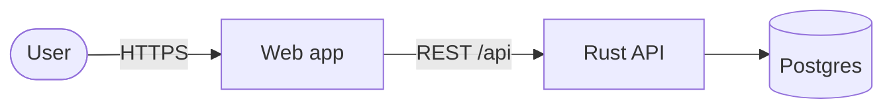
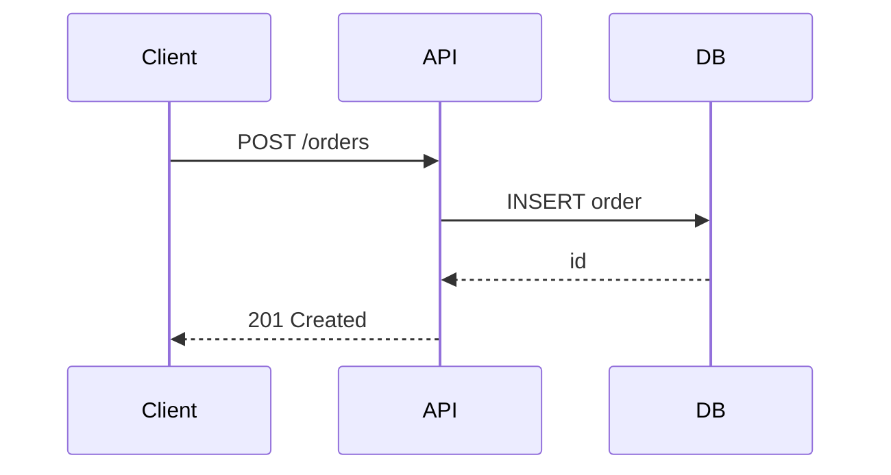

# Diagrams as code

Source files live in `diagrams/`; rendered output goes to `diagrams/out/`.
Render everything with `./diagrams/render.sh` (or one file:
`./diagrams/render.sh diagrams/flow.mmd`).

## Pick the tool

| Need | Use | File |
|---|---|---|
| Flowchart, sequence, state, ER, gantt | Mermaid | `name.mmd` |
| Architecture / containers / cloud layout, nested groups | D2 | `name.d2` |
| Graph generated from data | Graphviz `dot` | `name.dot` |

Mermaid also renders inline on GitHub and in many Markdown viewers; D2 gives
cleaner layouts for architecture. For live editing during a screen share run
`d2 --watch diagrams/name.d2` (opens a browser that reloads on save).

## Recipe

1. Ask (or infer) the level: **context** (system + users + external
   systems), **container** (services, DBs, queues), or **flow** (one request
   end to end). Draw one level per diagram.
2. Keep it under ~12 nodes. Label edges with the verb + protocol
   ("writes events · Kafka").
3. Write the file, render, then open the SVG (`open diagrams/out/name.svg`)
   or describe what it shows.
4. If it's for a decision, link it from the ADR.

## Mermaid starters





## D2 starter

```d2
direction: right
user: User {shape: person}
system: Platform {
  web: Web (TS)
  api: API (Rust)
  db: Postgres {shape: cylinder}
  web -> api: REST
  api -> db: SQL
}
user -> system.web: HTTPS
```

Check: `examples` in `diagrams/` (`architecture.d2`, `request-flow.mmd`).
